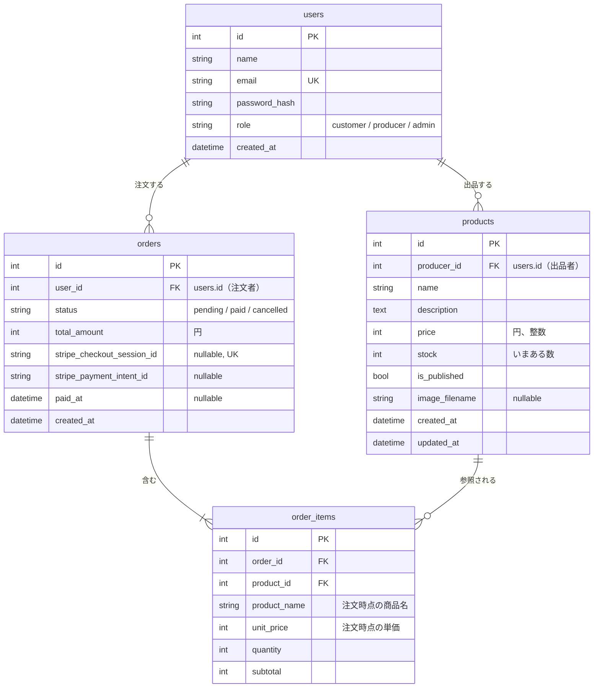

# データベース設計

## 前提

- Flask + Flask-SQLAlchemy（SQLAlchemy 2.x の `Mapped` / `mapped_column`）
- DB は **SQLite**（開発は `instance/`、テストはメモリ上）。本番公開（Day5）で MySQL に切り替えても動くように、**文字列のカラムには長さを付け、SQLite 専用の SQL や関数を使わない**
- カートはセッションに持つので、テーブルにしない
- テーブルは `users`、`products`、`orders`、`order_items` の4つ。ユーザーストーリー17本と S14 注文一覧（管理）は、この4つで足りる

 

## ER 図

出品者は `products.producer_id`、注文者は `orders.user_id`。どちらも `users.id` を指すので、カラム名で区別する。

 

## テーブル定義

### users（会員）

| カラム | 型 | 制約 | 説明 |
|-|-|-|-|
| id | integer | PK | |
| name | string(50) | not null | 表示名。生産者は農園名・屋号 |
| email | string(255) | not null, unique | ログインに使う。小文字にそろえて保存する |
| password_hash | string(255) | not null | パスワードのハッシュ（`werkzeug.security.generate_password_hash`）。**平文は保存しない** |
| role | string(20) | not null, default `customer` | `customer`（購入者）/ `producer`（生産者）/ `admin`（管理者） |
| created_at | datetime | not null | 登録日時 |

### products（商品）

| カラム | 型 | 制約 | 説明 |
|-|-|-|-|
| id | integer | PK | |
| producer_id | integer | not null, FK users.id, index | 出品した生産者 |
| name | string(50) | not null | 商品名。「ほうれん草 1束」のように量も入れる |
| description | text | not null, default `""` | 紹介文（2,000字まで） |
| price | integer | not null | 価格。円、税込み。50〜100,000 |
| stock | integer | not null, default 0 | いまある数。0〜999。**支払いが確定したときに減らす** |
| is_published | boolean | not null, default false | 公開中か。登録した直後は非公開 |
| image_filename | string(100) | nullable | 写真のファイル名（UUID + 拡張子）。写真が無ければ null |
| created_at | datetime | not null | 登録日時 |
| updated_at | datetime | not null | 更新日時。更新のたびに変わる |

### orders（注文）

| カラム | 型 | 制約 | 説明 |
|-|-|-|-|
| id | integer | PK | 注文番号として画面に出す |
| user_id | integer | not null, FK users.id, index | 注文した人 |
| status | string(20) | not null, default `pending` | `pending`（支払い待ち）→ `paid`（支払い済み）/ `cancelled`（取り消し） |
| total_amount | integer | not null | 合計金額（円）。明細の小計の合計をサーバーで計算する |
| stripe_checkout_session_id | string(255) | nullable, **unique** | Stripe の Checkout Session の ID。あとで支払いを確認するために使う。重複しない |
| stripe_payment_intent_id | string(255) | nullable | Stripe の支払いの ID。返金（拡張 E2）で使う |
| paid_at | datetime | nullable | 支払いが確定した日時 |
| created_at | datetime | not null | 注文日時。在庫の押さえ（35分）の起点 |

### order_items（注文明細）

| カラム | 型 | 制約 | 説明 |
|-|-|-|-|
| id | integer | PK | |
| order_id | integer | not null, FK orders.id, index | どの注文の明細か |
| product_id | integer | not null, FK products.id, index | どの商品か |
| product_name | string(50) | not null | **注文時点の商品名**。あとで商品名が変わっても注文は変わらない |
| unit_price | integer | not null | **注文時点の単価**（円）。あとで価格が変わっても注文は変わらない |
| quantity | integer | not null | 数量。1〜10 |
| subtotal | integer | not null | 小計（円）。`unit_price × quantity` |

 

## 外部キーの削除時の動き

| 関係 | 削除時 | 理由 |
|-|-|-|
| orders → order_items | **cascade** | 注文を消したら明細も要らない（コアでは注文を消す画面は無い） |
| products → order_items | **restrict** | 注文された商品が消えると、注文の記録が壊れる。**注文がある商品は削除させず、非公開にしてもらう** |
| users → products | 指定しない | コアではユーザーを削除しない |
| users → orders | 指定しない | 同上 |

SQLite は、設定しないと外部キーの制約（restrict）を確かめない。設定に SQLite 専用の書き方（`PRAGMA`）が要るため、**ビューの中で「注文がある商品は削除できない」を確かめる**。DB の制約だけに頼らないので、開発・テスト・本番で同じ動きになる。

 

## 決めたこと

- **状態は文字列 + Python の `StrEnum`**：`role` と `status` は DB には文字列で保存し、Python 側では `Role`、`OrderStatus` で値を定義する。打ち間違いを防ぎつつ、DB の中身は読める文字列のまま
- **金額は円の整数**：日本円に小数は無く、Stripe も JPY は整数で受け取る
- **注文の確定は条件付き更新**：`WHERE status = 'pending'` の UPDATE で `paid` にし、更新できた1回だけ在庫を減らしてメールを送る（二重処理の防止）
- **在庫**：いま買える数 = `products.stock` −（支払い待ちで、作成から35分以内の注文の数量の合計）

 

## ユーザーストーリーとテーブル

| ストーリー | 使うテーブル・カラム |
|-|-|
| 会員登録で立場を選ぶ | `users.role` |
| 商品の一覧と詳細 | `products`（`is_published = true`） |
| カートの数量を変える・外す | DB を使わない（セッション） |
| まとめてカードで支払う | `orders`、`order_items`（金額は DB の価格から計算） |
| 支払い途中で取り消す | `orders.status = cancelled` |
| 注文確認のメール | `orders.paid_at`（確定したときに1回だけ送る） |
| 注文履歴で金額を確かめる | `orders.total_amount`、`order_items.unit_price`（注文時点の値） |
| 写真付きで登録 | `products.image_filename` |
| 後から直す・削除する | `products`。注文がある商品は削除不可 → 非公開にする |
| 非公開で準備して公開 | `products.is_published` |
| 在庫より多く売らない | `products.stock` − 支払い待ち（35分以内）の数量 |
| 売上を見る | `order_items` を `products.producer_id` で絞り、`orders.status = paid` だけ集計 |
| 他人に編集させない | `products.producer_id` とログインユーザーの `id` を比べる |
| 管理者：全ての注文（S14） | `orders` + `users`（注文者の名前・メール） |
| 管理者：全ての商品（拡張 E15） | `products`（非公開も含む） |
