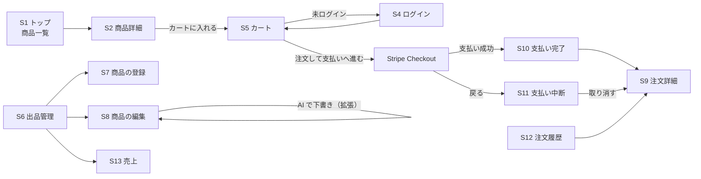

# 仕様書 2: 画面設計（参考解答）

> 自分で画面一覧を作ってから見比べてください。以降の章の指示例は、この画面名と URL で書いてあります。

## 画面一覧

| # | 画面 | URL | ログイン | ロール | 内容 | 時期 |
|:-:|-|-|:-:|-|-|:-:|
| S1 | トップ（商品一覧） | `/` | 不要 | 誰でも | 公開中の商品。写真、商品名、価格、生産者名、在庫（売り切れ） | Day4 |
| S2 | 商品詳細 | `/products/<id>` | 不要 | 誰でも | 写真、価格、紹介文、生産者名、在庫。数量を選んで「カートに入れる」。AI のレシピ提案（拡張 E19） | Day4 |
| S3 | 会員登録 | `/register` | 不要 | ─ | 名前、メール、パスワード、「購入者 / 生産者」の選択 | Day4 |
| S4 | ログイン | `/login` | 不要 | ─ | メール、パスワード | Day4 |
| S5 | カート | `/cart/` | 不要 | 誰でも | 商品、単価、数量（変更・0で削除）、小計、合計。「注文して支払いへ進む」 | Day4 |
| S6 | 出品管理 | `/producer/products` | 必要 | 生産者 | 自分の商品の一覧。公開状態、在庫。「公開する / 非公開にする」「削除」「商品を登録する」 | Day4 |
| S7 | 商品の登録 | `/producer/products/new` | 必要 | 生産者 | 商品名、価格、在庫数、紹介文、写真、公開するか | Day4 |
| S8 | 商品の編集 | `/producer/products/<id>/edit` | 必要 | 生産者（所有者） | S7 と同じ項目。（拡張 E18）**AI で紹介文を下書きする**フォーム（メモ） | Day4 |
| S9 | 注文詳細 | `/orders/<id>` | 必要 | 本人・管理者 | 注文の状態、明細、合計 | Day4 |
| S10 | 支払い完了 | `/orders/<id>/complete` | 必要 | 本人・管理者 | Stripe から戻る画面。確定していなければ「確認中」で5秒ごとに再読み込み | 平日 |
| S11 | 支払い中断 | `/orders/<id>/cancel` | 必要 | 本人・管理者 | Stripe で「戻る」を押したときの画面。「この注文を取り消す」 | 平日 |
| S12 | 注文履歴 | `/orders/` | 必要 | 全員 | 自分の注文を新しい順に。注文日時、合計、状態 | 平日 |
| S13 | 売上 | `/producer/sales` | 必要 | 生産者 | 自分の商品ごとの販売数と売上（支払い済みだけ）、合計 | 平日 |
| ─ | Stripe Checkout | （Stripe のサイト） | ─ | ─ | カード情報の入力。アプリの外 | 平日 |

URL の接頭辞で、誰の画面かが分かるようにしています（`/producer/` は生産者、`/orders/` はログインユーザー）。管理者の画面（`/admin/`）は拡張 E15 です。

### 画面ではない URL（POST だけ）

| URL | 内容 | ロール |
|-|-|-|
| `POST /logout` | ログアウト | ログインユーザー |
| `POST /cart/add/<id>` | カートに入れる（数量） | 誰でも |
| `POST /cart/update/<id>` | 数量を変える（0 なら外す） | 誰でも |
| `POST /orders/` | カートから注文を作る（平日課題で Stripe へリダイレクト） | ログインユーザー |
| `POST /producer/products/<id>/toggle` | 公開 / 非公開 の切り替え | 生産者（所有者） |
| `POST /producer/products/<id>/delete` | 削除（注文がある商品は削除できない） | 生産者（所有者） |
| `POST /producer/products/<id>/ai-description` | （拡張 E18）AI に紹介文の下書きを作らせ、編集画面を返す（保存はしない） | 生産者（所有者） |
| `POST /products/<id>/recipes` | （拡張 E19）AI にレシピを提案させ、商品詳細を返す | ログインユーザー |
| `POST /stripe/webhook` | Stripe からの通知（CSRF の対象外、署名で確かめる） | Stripe |

**値を変える操作は全て POST** にします。GET のリンクで削除や AI の呼び出しができると、リンクを踏ませるだけで操作されたり、クローラーが AI を呼んで費用がかかったりします。

 

## ナビゲーション

| ロール | ヘッダーのメニュー |
|-|-|
| 未ログイン | 商品一覧（ロゴ）、カート、ログイン、会員登録 |
| 購入者 | 商品一覧、カート、注文履歴、ログアウト |
| 生産者 | 商品一覧、カート、注文履歴、出品管理、売上、ログアウト |
| 管理者 | 購入者と同じ（管理画面は拡張 E15） |

 

## 画面遷移

 

## 各画面の要点

### S1 トップ・S2 商品詳細

- 公開中（`is_published = true`）の商品だけを出す
- 非公開の商品の詳細は、出品した生産者と管理者だけが見られる。それ以外の人には **404**（「ある」ことも教えない）
- 在庫は「いま買える数」（[仕様書 3](03_database.md) の在庫の計算）を出す。0 なら「売り切れ」で、カートに入れるボタンを出さない
- 数量のセレクトは 1〜min(10, いま買える数)

### S5 カート

- カートは**セッション**に `{"商品ID": 数量}` で持つ。ログインしていなくても使える
- 小計と合計は表示のために計算するだけ。注文を作るときは、サーバーが DB の価格で**計算し直す**
- 非公開になった商品はカートの表示から外す

### S7・S8 商品の登録・編集

- 価格 50〜100,000 円、在庫数 0〜999、商品名 50 字、紹介文 2,000 字
- 写真は JPEG / PNG / WebP、5MB まで。拡張子と中身の両方を確認する。保存するファイル名はランダム（UUID）にする（元のファイル名は使わない）
- 新しく登録した商品は「公開する」に印を付けなければ非公開
- （拡張 E18）S8 の「AI で紹介文を下書きする」: メモを送ると、AI の下書きが紹介文の欄に入った状態で S8 が表示される。**まだ保存されていない**ことを画面に出す。写真は登録済みのものを使う（先に写真を保存しておく）

### S10 支払い完了

- URL の `session_id` が注文に保存した Checkout Session の ID と一致し、注文が支払い待ちなら、Stripe に問い合わせて `payment_status = paid` なら支払い済みにする
- Webhook が先に届いていれば、注文は既に支払い済み
- 支払い待ちのままなら「確認中」と出し、5秒ごとに再読み込みする（`<meta http-equiv="refresh" content="5">`）

### S11 支払い中断

- 「この注文を取り消す」で、Stripe の Checkout Session を期限切れにしてから、注文を取り消し（`cancelled`）にする。押さえていた在庫が戻る
- 既に支払いが済んでいて期限切れにできないときは、取り消さずに注文詳細へ

 

## 認可のルール

認可は、**ビューの中の確認**で書きます。

| 対象 | 操作 | 許可 | 違反したとき | 書く場所 |
|-|-|-|-|-|
| 生産者の画面（`/producer/`） | 全て | ロールが producer | 未ログインはログインへ、他のロールは 403 | `@role_required(Role.PRODUCER)` |
| 商品 | 編集・削除・公開切り替え・AI 下書き（拡張） | 出品した生産者（`producer_id` が自分） | 403 | `get_own_product_or_403()` |
| 商品 | 閲覧（非公開） | 出品した生産者、管理者 | 404 | `can_view()` |
| 商品 | 閲覧（公開中） | 誰でも | ─ | ─ |
| 注文 | 作成 | ログインユーザー | ログインへ | `@login_required` |
| 注文 | 閲覧・完了・中断 | 注文した本人、管理者 | 403 | `get_own_order_or_403()` |
| レシピ提案（拡張） | 呼び出し | ログインユーザー（公開中の商品だけ） | ログインへ / 404 | `@login_required` |
| 管理者 | 作成 | 画面からは不可。`flask create-admin` だけ | 登録で `admin` を送ると 422 | `RegisterForm` の選択肢 |

- ボタンを隠すだけでは守れません。**URL を直接開いたり、POST を直接送ったりしても弾かれる**ことをテストで確かめます
- 「ロールの確認」（URL 単位）と「所有者の確認」（データ1件単位）は別物です。生産者でも、他の生産者の商品は編集できません
