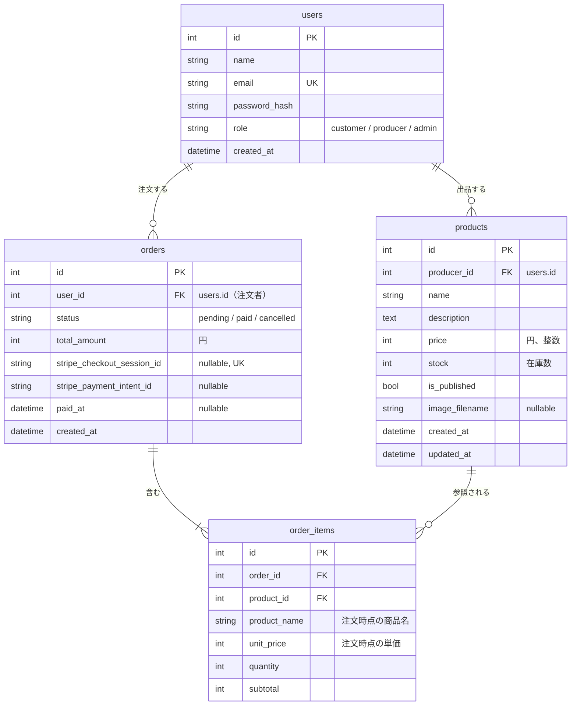

# 仕様書 3: データベース設計（参考解答）

> 自分で ER 図を作ってから見比べてください。以降の章の指示例は、このテーブル名とカラム名で書いてあります。

## ER 図



1週目の `product-board` では生産者を `producer_name`（文字列）で持ち、平日課題1で `producer_id` にしました。本命アプリでは生産者もログインするユーザーなので、**`products.producer_id` が `users.id` を指します**。注文した人は `orders.user_id` です。どちらも `users` を指すので、名前で区別します。

<br>

## テーブル定義

### users

| カラム | 型 | 制約 | 説明 |
|-|-|-|-|
| id | integer | PK | |
| name | string(50) | not null | 表示名。生産者は農園名・屋号 |
| email | string(255) | not null, unique | 小文字にそろえて保存する |
| password_hash | string(255) | not null | `werkzeug.security.generate_password_hash` の結果。**平文のパスワードは保存しない** |
| role | string(20) | not null, default `customer` | `customer` / `producer` / `admin` |
| created_at | datetime | not null | |

### products

| カラム | 型 | 制約 | 説明 |
|-|-|-|-|
| id | integer | PK | |
| producer_id | integer | FK users.id, index | 出品した生産者 |
| name | string(50) | not null | 「ほうれん草 1束」のように量も入れる |
| description | text | not null, default `""` | 紹介文。AI の下書きを生産者が直して保存する |
| price | integer | not null | 円、税込み。50〜100,000 |
| stock | integer | not null, default 0 | 在庫数。0〜999。**支払いが確定したときに減らす** |
| is_published | boolean | not null, default false | 公開中か |
| image_filename | string(100) | nullable | `marche/static/uploads/` の中のファイル名（UUID + 拡張子） |
| created_at | datetime | not null | |
| updated_at | datetime | not null | 更新のたびに変わる |

### orders

| カラム | 型 | 制約 | 説明 |
|-|-|-|-|
| id | integer | PK | 注文番号として画面に出す |
| user_id | integer | FK users.id, index | 注文した人 |
| status | string(20) | not null, default `pending` | `pending`（支払い待ち）/ `paid`（支払い済み）/ `cancelled`（取り消し） |
| total_amount | integer | not null | 合計金額（円）。明細の小計の合計 |
| stripe_checkout_session_id | string(255) | nullable, **unique** | Checkout Session の ID（`cs_test_...`）。Webhook と完了ページで注文と照らし合わせる |
| stripe_payment_intent_id | string(255) | nullable | 返金（拡張 E2）で使う |
| paid_at | datetime | nullable | 支払いが確定した日時 |
| created_at | datetime | not null | 在庫の押さえ（35分）の起点 |

### order_items

| カラム | 型 | 制約 | 説明 |
|-|-|-|-|
| id | integer | PK | |
| order_id | integer | FK orders.id, on delete cascade, index | |
| product_id | integer | FK products.id, on delete restrict, index | |
| product_name | string(50) | not null | **注文時点の商品名**。あとで商品名が変わっても注文は変わらない |
| unit_price | integer | not null | **注文時点の単価**。あとで価格が変わっても注文は変わらない |
| quantity | integer | not null | 1〜10 |
| subtotal | integer | not null | `unit_price × quantity` |

1回の注文に、複数の生産者の商品が入ることがあります。生産者ごとの売上は `order_items` を `products.producer_id` で絞って集計します。

<br>

## 決めたこと

### 状態は文字列 + Python の Enum

`role` と `status` は DB には文字列で保存し、Python 側では `enum.StrEnum`（`Role`、`OrderStatus`）で値を定義します。`StrEnum` は文字列と比べられる（`user.role == Role.PRODUCER`）ので、文字列の打ち間違いを防ぎつつ、DB の中身は TablePlus で読める文字列のままです。

### 金額は円の整数

小数は使いません（日本円に小数はなく、Stripe も JPY は整数で受け取ります）。単価と小計は明細に保存し、**注文時点の値**を残します。

### 削除の動き

| 関係 | 削除時 | 理由 |
|-|-|-|
| orders → order_items | cascade | 注文を消したら明細も要らない（コアでは注文を消す画面は無い） |
| products → order_items | restrict | 注文された商品が消えると、注文の記録が壊れる。**注文がある商品は削除させず、非公開にしてもらう** |
| users → products / orders | （何もしない） | コアではユーザーを削除しない |

> SQLite は、設定しないと外部キーの制約（restrict）を確かめません。本番の MySQL（InnoDB）は必ず確かめますが、開発とテストの SQLite では確かめないので、参考実装はビューの中で「注文がある商品は削除できない」を確かめています。DB の制約だけに頼らないと、開発・テスト・本番で同じ動き（同じメッセージ）になります。

<br>

## 在庫の計算（方針と理由）

### 方針

```text
いま買える数 = products.stock − （支払い待ちで、作成から35分以内の注文の数量の合計）
```

- `products.stock` は「生産者が入力した、いまある数」。**支払いが確定したとき（Webhook か完了ページ）に減らす**
- 注文を作るとき（カート → 注文）と、一覧・詳細の表示では、`stock` から「支払い待ち（35分以内）」の数を引いた「いま買える数」を使う
- 35分を過ぎた支払い待ちは数えない（決済ページを閉じたまま放置した人の分が、いつまでも在庫を押さえないように）
- 計算は `marche/services/inventory.py` の `available_stock(product)` に置く

### 2つの方式を比べて、この方式にした理由

| 方式 | 中身 | 利点 | 欠点 |
|-|-|-|-|
| A. 毎回計算 | `stock` は「入荷した総数」。いま買える数 = 総数 − 支払い済み − 支払い待ち | 減算の処理が要らない。二重に減る心配がない | 生産者が「いま10個ある」と入れたいのに、「これまでに入荷した総数」を入れないといけない。補充のたびに計算が要る |
| B. 支払い完了時に減算（採用） | `stock` は「いまある数」。支払い確定で減らす | **生産者の感覚と同じ**（収穫したら「いまの数」に書き換えるだけ）。売れた分が `stock` に反映される | 確定の処理が二重に走ると二重に減る → **条件付き更新**で防ぐ |

産直品は毎日収穫して在庫を足すので、生産者が「いまの数」をそのまま入れられる B を選びました。B の欠点（二重減算）は、[仕様書 4](04_flows_tests_seed.md) の「`pending` のときだけ `paid` に更新する」条件付き更新で防ぎます。

### なぜ支払い待ちも引くのか、なぜ35分か

- 支払い待ちを引かないと、Aさんが Stripe の画面でカード番号を入れている間に、Bさんが最後の1個を買えてしまいます
- Stripe の Checkout Session の有効期限は**最短30分**です。参考実装は時計のずれを見込んで31分にし、在庫の押さえはそれより少し長い35分にしています。期限が切れた決済ページでは支払えないので、35分を過ぎた支払い待ちは数えなくてよい、という理屈です
- 「支払い待ちが多すぎて買えない」状態が気になる人は、中断ページで取り消せます（押さえが戻ります）

### この方式で残る問題

- 2人が**同時に**最後の1個を注文すると、両方の注文が通ることがあります（確認と作成の間に隙間がある）。支払い確定時に `stock` が足りなければ 0 で止めますが、片方は「売れたのに在庫がない」状態になります。対策（行ロック、条件付きの減算、在庫不足なら返金）は**拡張 E1**で扱います
- 一覧で商品ごとに集計の SQL が走ります（8商品なら8回）。拡張 E16 で1回にまとめます

<br>

## SQLAlchemy のモデルとリレーション

| モデル | リレーション |
|-|-|
| User | `products`（出品した商品）、`orders`（注文） |
| Product | `producer`（User）、`order_items` |
| Order | `user`（User）、`items`（OrderItem。`cascade="all, delete-orphan"`） |
| OrderItem | `order`、`product` |

- 書き方は SQLAlchemy 2.x の `Mapped` / `mapped_column`（1週目の `product-board` と同じ）
- Python 3.14 では、後で定義するクラスを型ヒントに書くときに引用符が要りません（`Mapped[list[OrderItem]]`）。Ruff も引用符を外すように指摘します

<br>

## マイグレーション

Flask-Migrate を使います。テーブルを足したり変えたりしたら、次の2つを実行します。

```bash
uv run flask db migrate -m "add products"
uv run flask db upgrade
```

- 1週目の `db.create_all()` は「無いテーブルを作る」だけで、カラムの追加はできません。本番のデータを残したままテーブルを変えるためにマイグレーションを使います
- テスト（メモリ上の SQLite）は毎回空なので、`conftest.py` で `db.create_all()` を使います
- `migrations/` は Alembic が生成したコードなので、Ruff の対象から外します（`pyproject.toml` の `[tool.ruff] extend-exclude = ["migrations"]`）
