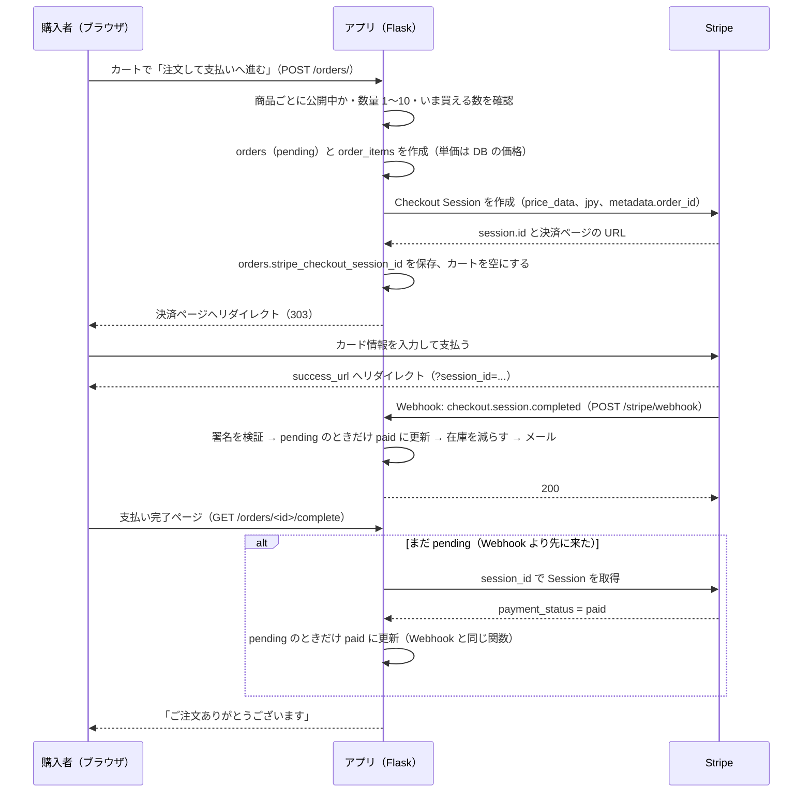

# 仕様書 4: 決済とメールの流れ、テスト、初期データ

> Day4 ではテストの一覧（T1〜T12）と初期データを、平日課題（07〜10 章）では決済とメールの流れを使います。

## 購入の流れ



支払いの確定は2つの経路から来ます。**どちらが先でも、どちらが2回来ても、確定は1回だけ**になるようにします（下の「条件付き更新」）。

<br>

## Stripe の実装方針

- Python SDK `stripe`（16.x）を使う。キーを持たせた **`stripe.StripeClient`** を作り、`client.v1.checkout.sessions.create({...})` のように呼ぶ（Stripe の公式ドキュメントの現在の書き方。`stripe.api_key = ...` を書き換えるモジュール全体の設定は使わない）
- Stripe を呼ぶコードは **`marche/services/payment.py` だけ**に書く。関数は3つ
  - `create_checkout_session(order) -> (session_id, url)`
  - `retrieve_session(session_id)`（完了ページで使う）
  - `expire_session(session_id)`（中断ページで使う）
  - 失敗（`stripe.StripeError`）は `PaymentError`（画面に出せる日本語）にして投げ直す
- Checkout Session は `mode = "payment"`、`line_items` に `price_data`（`currency = "jpy"`、`unit_amount = 明細の単価`、`product_data.name = 明細の商品名`）と `quantity`。Stripe 側に商品を事前登録しない
- **金額は注文明細（DB）から取る**。フォームやカート（セッション）の金額は使わない。JPY は小数の無い通貨なので、`unit_amount` は円のまま（100倍しない）
- `metadata.order_id` に注文 ID を入れる。`expires_at` は31分後（Stripe の最短は30分）
- `success_url` は `/orders/<id>/complete?session_id={CHECKOUT_SESSION_ID}`（`{CHECKOUT_SESSION_ID}` は Stripe が置き換える）、`cancel_url` は `/orders/<id>/cancel`
- Checkout Session を作れなかったら、作った注文を取り消して、カートに戻す

### Webhook

- `POST /stripe/webhook`。Flask-WTF の CSRF の対象から外す（`@csrf.exempt`）。代わりに**署名を検証**する
- `stripe.Webhook.construct_event(payload, Stripe-Signature ヘッダー, STRIPE_WEBHOOK_SECRET)`。失敗（`ValueError`、`stripe.SignatureVerificationError`）は **400** を返し、何も変えない
- 扱うイベントは **`checkout.session.completed` のみ**（拡張 E2 で `charge.refunded` を足す）。他のイベントは何もせず 200 を返す（エラーを返すと Stripe が再送し続ける）
- `payment_status` が `paid` のときだけ確定する。`metadata.order_id` の注文を探し、その注文の `stripe_checkout_session_id` が Webhook の Session の ID と一致することも確かめる
- 確定は `marche/services/inventory.py` の `mark_as_paid(order, payment_intent_id) -> bool` の1か所。Webhook と完了ページの両方から呼ぶ

### 条件付き更新（二重処理の防止）

```sql
UPDATE orders SET status = 'paid', paid_at = ..., stripe_payment_intent_id = ...
WHERE id = ? AND status = 'pending'
```

- 更新できた行数が 1 なら「自分が確定させた」→ 在庫を減らしてメールを送る。0 なら「既に確定済み（または取り消し済み）」→ 何もしない（`False` を返す）
- 「読んで、pending なら paid にして保存」と2段階で書くと、Webhook と完了ページが同時に来たとき、両方が pending を読んで在庫を二重に減らします。**読む・確かめる・書くを1つの UPDATE 文にする**のがポイントです
- 取り消し（`cancel`）も同じく `WHERE status = 'pending'` の条件付き更新です。取り消した注文に、後から Webhook が来ても支払い済みにはなりません

### 在庫の減算

- 確定した注文の明細ごとに `UPDATE products SET stock = stock - 数量`（足りなければ 0）
- 0 で止まった場合は「売れたのに在庫がない」状態です。コアではログに残すだけで、対策は拡張 E1

### 環境変数

| 変数 | 内容 | 開発 | 本番 |
|-|-|-|-|
| `STRIPE_SECRET_KEY` | シークレットキー（`sk_test_...` / `sk_live_...`） | テスト | キャンプ中はテスト |
| `STRIPE_PUBLISHABLE_KEY` | 公開可能キー（`pk_test_...`）。Checkout へリダイレクトする方式では使わないが、拡張のために入れておく | テスト | テスト |
| `STRIPE_WEBHOOK_SECRET` | Webhook の署名シークレット（`whsec_...`） | `stripe listen` が表示する値 | Stripe のダッシュボードで登録して取得（Day6） |

### 開発環境での Webhook

- Stripe CLI の `stripe listen --forward-to localhost:8000/stripe/webhook` でローカルに転送する
- CLI を入れない場合は、完了ページの経路（Stripe に問い合わせる）だけでも確定できる。Webhook は Day6 の本番で確かめる

<br>

## メール

| メール | 送るとき | 宛先 | 内容 |
|-|-|-|-|
| 注文確認 | `mark_as_paid` が `True` を返したとき（1回だけ） | 注文者 | 件名「【はちまん産直マルシェ】ご注文ありがとうございます（注文番号 N）」。商品名・単価・数量・小計、合計、注文詳細の URL |

- 送る処理は `marche/services/mail.py` の `send_order_paid(order)`。**開発ではログ（ターミナル）に出すだけ**（`MAIL_BACKEND=log`）
- 本番で送るときは `MAIL_BACKEND=smtp` にし、`MAIL_SERVER`、`MAIL_PORT`、`MAIL_USE_TLS`、`MAIL_USERNAME`、`MAIL_PASSWORD`、`MAIL_FROM` を設定する（Resend の SMTP など。Day6）
- メールが送れなくても、注文の確定は取り消さない（ログに残す）
- テスト中（`app.testing`）は `app.extensions["mail_outbox"]` に溜め、テストで件数を確かめる
- 本番のメール送信（Resend など）は、ドメインがある人だけ（Day6）

<br>

## テストの方針

- pytest。テストの DB は**メモリ上の SQLite**（`sqlite:///:memory:`）で、テストごとに作り直す
- テストでは**本物の Stripe（拡張で AI 機能を足した人は Claude API も）を呼ばない**。`create_app()` に渡す設定で差し替える

`tests/conftest.py`（抜粋）

```python
app = create_app(
    {
        "TESTING": True,
        "SQLALCHEMY_DATABASE_URI": "sqlite:///:memory:",
        "WTF_CSRF_ENABLED": False,
        "UPLOAD_FOLDER": str(tmp_path / "uploads"),
        "STRIPE_WEBHOOK_SECRET": "whsec_test",
        "PAYMENT_SERVICE": fake_payment,
        # 拡張 E18 で AI 機能を足した人は "AI_SERVICE": fake_ai も
    }
)
```

- `create_app()` は `app.extensions["payment"]`（AI 機能を足した人は `app.extensions["ai"]` も）に、設定で渡されたフェイクか、本物のモジュール（`services/payment.py`、`services/ai.py`）を入れる。ビューは必ず `current_app.extensions["payment"]` 経由で呼ぶ
- フェイクは本物と同じ名前の関数（メソッド）を持ち、呼ばれた引数を記録し、決まった値を返す。`error` に例外を入れておくと、失敗の場面も試せる
- Webhook のテストは、フェイクではなく**本物の署名の検証**を通す。署名は `stripe.WebhookSignature.generate_signature_header(payload, secret)`（Stripe と同じ HMAC-SHA256）で作る
- CSRF はテストでは切るが、「CSRF トークンの無い POST が 400 になる」「Webhook は CSRF の対象外」の2本だけは CSRF を有効にして確かめる

<br>

## テスト一覧

### Day4（コア）

| # | テスト | 確認すること |
|:-:|-|-|
| T1 | 会員登録 | 生産者として登録でき、出品管理にリダイレクトされる |
| T2 | 管理者は選べない | 登録で `role=admin` を送ると 422 で、ユーザーは作られない |
| T3 | ロールの確認 | 購入者が `/producer/products` を開くと 403。未ログインはログインへ |
| T4 | 商品の登録 | 生産者は登録できる。価格が 50 円未満なら 422 |
| T5 | 他人の商品 | 他の生産者の商品の編集・削除は 403 で、変わらない |
| T6 | 写真 | PNG を登録できる。拡張子が `.png` でも中身が画像でなければ 422。`.gif` は 422 |
| T7 | 公開の切り替え | 非公開 → 公開に切り替えられる |
| T8 | 一覧と詳細 | 公開中だけが一覧に出る。非公開の詳細は出品者以外 404。在庫 0 は「売り切れ」 |
| T9 | 注文（正常） | 合計が DB の価格 × 数量で計算される。フォームに金額を混ぜても無視される |
| T10 | 注文（在庫・非公開） | 在庫を超える数、非公開の商品は `OrderError` で、注文は作られない |
| T11 | 在庫の押さえ | 支払い待ちの数だけ「いま買える数」が減る。35分を過ぎた支払い待ちは引かない |
| T12 | 他人の注文 | 他人の注文詳細は 403 |

### 平日課題

| # | テスト | 確認すること |
|:-:|-|-|
| T13 | Stripe へ移動 | 注文するとフェイクの決済ページの URL へ 303。`stripe_checkout_session_id` が保存される |
| T14 | Stripe の失敗 | `PaymentError` なら注文を取り消し、メッセージを出す |
| T15 | `services/payment.py` | `line_items` の `unit_amount` が明細の単価、`currency` が `jpy`、`metadata.order_id` が入る |
| T16 | Webhook（正常） | 正しい署名で `paid` になり、在庫が減り、メールが1通 |
| T17 | Webhook（署名） | 署名が違う・無いと 400 で、注文は変わらない |
| T18 | Webhook（二重） | 同じ Webhook が2回来ても、在庫は1回だけ減り、メールも1通 |
| T19 | Webhook（未払い・取り消し済み） | `payment_status` が `unpaid` なら確定しない。取り消し済みの注文は `paid` にならない |
| T20 | 完了ページ | Stripe（フェイク）が `paid` を返せば確定する |
| T21 | 中断ページ | 取り消すと `cancelled` になり、Session を期限切れにし、在庫の押さえが戻る |
| T22 | CSRF | トークンの無い POST は 400。Webhook は CSRF ではなく署名で 400 |
| T23 | 売上 | 自分の商品の支払い済みだけが集計される。購入者は 403 |
| T24 | コマンド | `flask create-admin` で管理者を作れる。`flask seed` で初期データが入る |

### 拡張モジュール（AI 機能を足した人だけ）

| # | テスト | 確認すること |
|:-:|-|-|
| TA1 | AI 下書き（E18） | 下書きが編集画面に入り、**DB は変わらない**。AI の失敗はメッセージを出す。メモが長すぎると AI を呼ばない。他人の商品では呼べない |
| TA2 | `services/ai.py`（E18） | 画像とタグで囲んだメモが API に渡る。タイムアウトと API キー無しは `AIError` |
| TA3 | レシピ（E19） | ログインが必要。結果が詳細ページに出る |

<br>

## 初期データ（`uv run flask seed`）

| データ | 件数 | 内容 |
|-|:-:|-|
| 管理者 | 1 | `admin@example.com` / `password` |
| 生産者 | 2 | `producer1@example.com`（高原ファーム）、`producer2@example.com`（岩手山麓工房） / `password` |
| 購入者 | 2 | `customer1@example.com`、`customer2@example.com` / `password` |
| 商品 | 8 | 下の表 |

| 生産者 | 商品名 | 価格 | 在庫 | 状態 |
|-|-|-:|-:|-|
| 高原ファーム | 八幡平マッシュルーム 200g | 450 | 20 | 公開 |
| 高原ファーム | 安代りんどう 切り花 5本 | 800 | 10 | 公開 |
| 高原ファーム | ほうれん草 1束 | 180 | 30 | 公開 |
| 高原ファーム | 試作中の干し野菜セット | 600 | 5 | 非公開 |
| 岩手山麓工房 | 八幡平ポーク ロース 300g | 1,200 | 8 | 公開 |
| 岩手山麓工房 | 手づくり味噌 1kg | 1,300 | 12 | 公開 |
| 岩手山麓工房 | りんごジュース 1L | 700 | 15 | 公開 |
| 岩手山麓工房 | 地熱野菜のピクルス | 550 | 0 | 公開（売り切れの例） |

- 実行するたびに全データを消してから入れ直す（開発用）。**本番では実行しない**。本番の管理者は `uv run flask create-admin` で作る
- 写真はシードに含めない（各自で撮った写真を登録して試す）
- 注文はシードに含めない（自分で買って確かめる）
